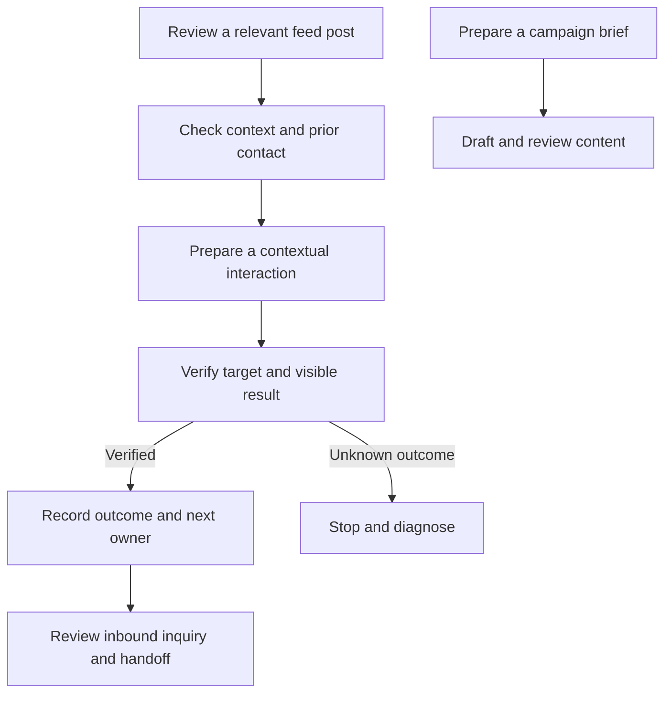

# XHS Discovery, Interaction & AI Operations

**Turning a real social-marketing workflow into clear decisions, verifiable actions, and reliable follow-up.**

By **Yi Liang** · Marketing operations, workflow debugging, and AI-assisted process design

## Start here

I developed and refined a Xiaohongshu (XHS) marketing workflow for an **independent PhD application advisory studio**. The work connected relevant-post discovery, contextual interactions, content preparation, inbound questions, and colleague handoffs.

**My main contribution was debugging the discovery and interaction process:** deciding which posts were relevant, retaining the right person's context, verifying what actually happened, and preventing an uncertain action from being repeated. I then built this English public demonstration with AI-assisted coding and documentation.

This repository reconstructs the workflow with fictional examples. Historical aggregate counts describe its operating scale; public row-level records are synthetic. **The demo runs offline, without a browser, account, or model API.**

## A two-minute review

| Time | Open | What to look for |
|---|---|---|
| 30 seconds | This page: contribution and scale below | The business problem, my role, and the scope of the evidence |
| 1 minute | [Debugging case study](docs/DEBUGGING_CASE_STUDY.md) | How I separated a reserved retry from an executed action, and what remained unresolved |
| 30 seconds | [Discovery and interaction](docs/DISCOVERY_AND_INTERACTION.md) | How context, history checks, and outcome verification inform the next step |

**Prefer a visual overview?** Download or clone this repository, then open [outputs/report.html](outputs/report.html) in your browser. It is a self-contained report; no setup is required. GitHub shows HTML source rather than the rendered page. The documents above can be read directly on GitHub.

## What the work demonstrates

| Capability | My work | Evidence to inspect |
|---|---|---|
| Business-process design | Connected post review, interaction, verification, and follow-up instead of treating each as a separate task | [Workflow decisions](docs/DISCOVERY_AND_INTERACTION.md) |
| Iterative debugging | Investigated ambiguous execution records and separated reservation, attempt, result, and later observation | [Diagnosis and correction](docs/DEBUGGING_CASE_STUDY.md) |
| Contextual judgment | Distinguished an actual request from unrelated content, checked prior contact, and avoided confusing a post's author with another person | [Discovery replay](workflow/discovery.py) |
| Data operations | Made record types, relationships, and validation checks explicit across four backend tables | [Data model](docs/BACKEND_DATA_MODEL.md) |
| AI-assisted marketing operations | Organized briefs, draft review, inquiry summaries, and consultant handoffs with explicit unknowns | [Business case](docs/CASE_STUDY.md) and [prompt templates](#complete-file-guide) |

### A representative debugging decision

**Problem:** a retry allowance had been reserved, but the execution record did not establish whether the action ran. A later healthy page view could not answer that question.

**Correction:** record reservation, submission, success, failure, and unknown outcome separately. Keep an uncertain action stopped rather than treating an observation as proof of completion.

**Evidence and limit:** archived records describe an isolated correction with 20 passing synthetic checks. The external access restriction remained unresolved. This repository supplies a separate, testable reconstruction; it does not claim that the original workflow restarted or that the two test suites are the same.

## Historical operating scale

| Saved record type | Records | What a record represents |
|---|---:|---|
| Lead / context | **606** | A stored context and follow-up record, not necessarily a customer |
| Operation event | **1,771** | A logged step or observation, not necessarily successful outreach |
| Execution run | **39** | A run summary; records span **29 distinct recorded dates** |
| Mentor profile | **95** | A resource profile, not a claim of current availability |

These counts come from a saved 2026 snapshot; the exact operating date is withheld. Lead, event, and run counts were reconciled between CSV and Excel views; mentor counts come from the CSV snapshot. [Definitions and validation](docs/BACKEND_DATA_MODEL.md).

The bundled [synthetic backend tables](data/synthetic_backend/) match these volumes with entirely new records and relationships. The smaller rule examples in the demo are separate test inputs, not the scale of the backend. No revenue attribution, conversion lift, or measured time saving is claimed.

## How the workflow fits together



The public code demonstrates decisions and recorded outcomes. It does not retrieve posts, publish content, send messages, or run a live AI model. The [prompt templates](#complete-file-guide) support a separate, manual drafting process.

## Run the optional technical demo

Python **3.10+**, standard library only. From the repository root:

```bash
python -m workflow demo
python -m unittest discover -s tests -v
```

The first command regenerates the report and supporting files in `outputs/`; the second checks the reconstructed behavior. A recruiter can review the project without running either command. For commands, expected outputs, and the optional approval example, see the [walkthrough](docs/WALKTHROUGH.md).

## Scope and ownership

My contribution includes translating the operating problem into explicit rules, refining discovery and verification, debugging ambiguous recovery states, and developing this public reconstruction with AI assistance. The Python implementation and English prompts are portfolio work; they are not a release of employer source code.

Organization identifiers, mentor identities, accounts, messages, and private configuration are excluded. Public examples do not carry permission to contact anyone. See [PRIVACY.md](PRIVACY.md) for the release boundary and [EVALUATION.md](docs/EVALUATION.md) for checks and proposed pilot measures.

## Complete file guide

The two-minute route above is enough for an initial review. Expand a section below when you want to inspect the supporting evidence. **Every file in the release is listed with its purpose.**

<details>
<summary><strong>Reading material — business context, debugging, and evidence</strong></summary>

| File | Purpose / when to read it |
|---|---|
| [README.md](README.md) | Start here: project purpose, contribution, scale, and navigation. |
| [docs/CASE_STUDY.md](docs/CASE_STUDY.md) | Understand the business problem, design trade-offs, and my contribution. |
| [docs/DEBUGGING_CASE_STUDY.md](docs/DEBUGGING_CASE_STUDY.md) | Inspect the main debugging example: symptom, diagnosis, correction, and unresolved question. |
| [docs/DISCOVERY_AND_INTERACTION.md](docs/DISCOVERY_AND_INTERACTION.md) | Understand candidate review, context, prior-contact checks, and verification. |
| [docs/BACKEND_DATA_MODEL.md](docs/BACKEND_DATA_MODEL.md) | Understand record definitions, relationships, historical counts, and synthetic-data boundaries. |
| [docs/WORKFLOW_SPEC.md](docs/WORKFLOW_SPEC.md) | Inspect the supporting content and inquiry rules, including review and handoff. |
| [docs/EVALUATION.md](docs/EVALUATION.md) | See what is tested now and what a future business pilot would need to measure. |
| [docs/WALKTHROUGH.md](docs/WALKTHROUGH.md) | Run the demo, interpret its outputs, and reproduce the optional approval example. |
| [PRIVACY.md](PRIVACY.md) | Review what was removed, what remains public, and how the release is packaged. |

</details>

<details>
<summary><strong>Visual report and generated evidence — outputs/</strong></summary>

These files are produced by `python -m workflow demo`. Most readers only need the HTML report. JSON files expose the underlying decisions for technical review; they are not additional business-performance claims.

| File | Purpose |
|---|---|
| [outputs/report.html](outputs/report.html) | Self-contained visual overview of contribution, scale, verification, and debugging; open locally in a browser. |
| [outputs/backend_snapshot_profile.json](outputs/backend_snapshot_profile.json) | Generated copy of the historical aggregate profile for the report; no private source rows. |
| [outputs/synthetic_backend_analysis.json](outputs/synthetic_backend_analysis.json) | Counts and relationship checks computed from all four synthetic CSV tables. |
| [outputs/discovery_plan.json](outputs/discovery_plan.json) | Candidate decisions, retained context, and reasons from fictional post examples. |
| [outputs/interaction_verification.json](outputs/interaction_verification.json) | Contrasts a verified result, a send click without a result, and a wrong-target result. |
| [outputs/debug_replay.json](outputs/debug_replay.json) | Step-by-step recovery states showing why a later observation cannot prove an earlier action ran. |
| [outputs/leads.json](outputs/leads.json) | Deduplicated small inquiry example with scores, missing information, and hold reasons. |
| [outputs/duplicates.json](outputs/duplicates.json) | Identifies the duplicate removed from the small inquiry example. |
| [outputs/review_queue.json](outputs/review_queue.json) | Eligible inquiry items with a proposed next step and a fixed reply template for review. |
| [outputs/action_manifest.json](outputs/action_manifest.json) | Approved items from the local review example; empty at baseline and never a sending instruction. |
| [outputs/content_drafts.json](outputs/content_drafts.json) | Fixed, synthetic content concepts labeled as pending review; not live model output. |
| [outputs/metrics.json](outputs/metrics.json) | Counts for the small rule examples only, separate from historical and full-volume data. |
| [outputs/triage.md](outputs/triage.md) | Human-readable inquiry-review table for the small example. |
| [outputs/reproducibility.txt](outputs/reproducibility.txt) | Output fingerprint, fixed example date, and network-call count for reproducibility. |

</details>

<details>
<summary><strong>Data inputs — historical aggregates and fictional public examples</strong></summary>

Only the aggregate profile contains historical measurements. CSV rows and the smaller JSON examples are synthetic; they do not map to identifiable source records.

| File | Purpose |
|---|---|
| [data/backend_snapshot_profile.json](data/backend_snapshot_profile.json) | Historical table counts, definitions, and grouped state distributions with exact dates withheld. |
| [data/synthetic_backend/leads.csv](data/synthetic_backend/leads.csv) | 606 fictional context records linked to synthetic mentor profiles. |
| [data/synthetic_backend/events.csv](data/synthetic_backend/events.csv) | 1,771 fictional operation events linked to synthetic leads and runs. |
| [data/synthetic_backend/runs.csv](data/synthetic_backend/runs.csv) | 39 fictional run summaries across 29 fictional dates. |
| [data/synthetic_backend/mentors.csv](data/synthetic_backend/mentors.csv) | 95 fictional resource profiles; no real mentor identities. |
| [data/synthetic_posts.json](data/synthetic_posts.json) | Small post/profile examples isolating relevance, history, recipient, and uncertain-outcome rules. |
| [data/synthetic_inquiries.json](data/synthetic_inquiries.json) | 12 inquiry examples covering duplicates, missing context, permissions, and lifecycle holds. |
| [data/synthetic_event_brief.json](data/synthetic_event_brief.json) | Fictional campaign facts and unknowns for the manual drafting prompt. |
| [data/synthetic_content_drafts.json](data/synthetic_content_drafts.json) | Three fixed content examples used by the offline demo. |
| [data/synthetic_review_ledger.json](data/synthetic_review_ledger.json) | Seeded approval history for demonstrating a review allowance and repeat-safe approval. |

</details>

<details>
<summary><strong>English prompt templates — manual AI-assisted work</strong></summary>

These new public templates document how AI can support an operator. They do not run automatically, and they contain no employer prompt text.

| File | Purpose |
|---|---|
| [prompts/01_content_drafting.md](prompts/01_content_drafting.md) | Turn an authorized brief into three draft concepts while preserving unknown facts. |
| [prompts/02_inquiry_summary.md](prompts/02_inquiry_summary.md) | Summarize an inbound question and propose a reply for colleague review. |
| [prompts/03_editorial_review.md](prompts/03_editorial_review.md) | Flag unsupported claims, unclear wording, privacy issues, and missing context before human review. |
| [prompts/04_discovery_review.md](prompts/04_discovery_review.md) | Review a supplied post/profile candidate, check history, and prepare a contextual draft. |

</details>

<details>
<summary><strong>Implementation and checks — for technical reviewers</strong></summary>

A replay repeats decision steps with fictional inputs; it does not repeat actions on the platform.

| File | Purpose |
|---|---|
| [workflow/discovery.py](workflow/discovery.py) | Apply candidate-review rules and check whether the intended interaction result is actually visible. |
| [workflow/recovery.py](workflow/recovery.py) | Model retry reservation, submission, result, and stop behavior without browser actions. |
| [workflow/backend.py](workflow/backend.py) | Load all public CSVs and validate identifiers, relationships, dates, and aggregate counts. |
| [workflow/pipeline.py](workflow/pipeline.py) | Process the small inquiry example, record optional approvals, and generate reports. |
| [workflow/__main__.py](workflow/__main__.py) | Entry point for the `python -m workflow` commands. |
| [workflow/__init__.py](workflow/__init__.py) | Defines the Python package and its public scope. |
| [tests/test_discovery.py](tests/test_discovery.py) | Check candidate relevance, recipient identity, history, and interaction verification. |
| [tests/test_recovery.py](tests/test_recovery.py) | Check state transitions and preserve stops after uncertain outcomes. |
| [tests/test_backend.py](tests/test_backend.py) | Check full-table counts, identifier uniqueness, and cross-table references. |
| [tests/test_workflow.py](tests/test_workflow.py) | Check inquiry deduplication, prioritization, review limits, and repeat-safe approvals. |
| [tests/test_release_privacy.py](tests/test_release_privacy.py) | Check the release allowlist, excluded files, neutral archive metadata, and withheld date policy. |
| [scripts/build_release.py](scripts/build_release.py) | Build a ZIP using only approved public files and fixed archive timestamps. |
| [.github/workflows/checks.yml](.github/workflows/checks.yml) | Configure GitHub checks to run tests, regenerate outputs, and flag output drift after publication. |
| [.gitignore](.gitignore) | Keep runtime state, raw workbooks, logs, credentials, and caches out of normal Git staging. |

</details>

© 2026 Yi Liang. No open-source license is granted in this initial portfolio release.
