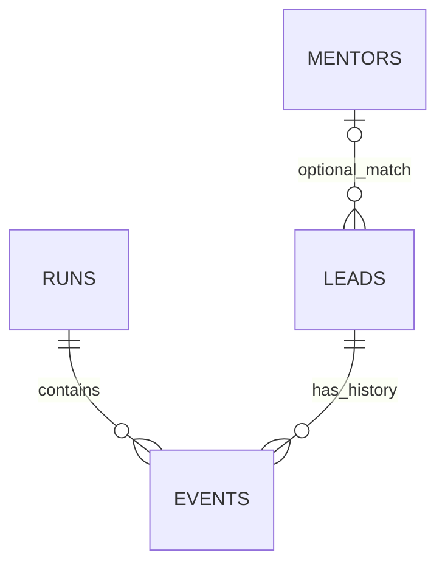

# Backend data model and record volume

**Purpose:** Explain the four backend tables, their relationships and what the historical counts do—and do not—measure. Read this for data-operations and analytical evidence.

[Back to the project overview](../README.md) · [Next: evaluation and limitations](EVALUATION.md)

The operating workflow maintained a backend across event history, latest lead/context state, execution-run summaries and mentor-profile records. A reviewed historical snapshot contained **606 lead/context records, 1,771 events, 39 runs across 29 distinct run dates, and 95 mentor profiles**. Its three event, lead and run Excel views reconciled to the corresponding CSV row counts.

Those counts describe record volume. They do not mean 606 paying customers, 1,771 successful contacts, 39 continuous days of operation, or 95 mentors currently available. Multiple events can belong to one lead; run dates can repeat; a mentor profile is not a confirmed availability promise.

## Public data

[The public backend tables](../data/synthetic_backend/) contain newly constructed records at the same row volumes. **Only the table counts and the number of distinct run dates match the reviewed snapshot. Every identifier, row value, date, relationship, distribution and outcome is fictional.** The simplified public schemas (the fields in each table) do not reproduce the private source tables. Every row carries `synthetic=true`.

| Public table | Rows | Public fields |
|---|---:|---|
| `leads.csv` | 606 | `lead_id`, `topic`, `stage`, optional `mentor_id`, `synthetic` |
| `events.csv` | 1,771 | `event_id`, `run_id`, `lead_id`, `event_type`, `event_status`, `synthetic` |
| `runs.csv` | 39 | `run_id`, `run_date`, `status`, `synthetic` |
| `mentors.csv` | 95 | `mentor_id`, `specialty`, `availability`, `synthetic` |

All synthetic dates fall in a fictional 2030 demonstration period. Mentor statuses explicitly describe the demonstration. No names, schools, profile images, original messages, post URLs, original platform IDs, internal catalog text or contact information are included.

## Relationships



Each event references an existing lead and run. A lead may reference a fictional mentor, or leave that reference empty until a resource is considered. Each table's primary key is a unique record ID. Repeated events add history without creating a new lead record: the event table explains **what happened**, while the lead table explains **the latest recorded state**.

The synthetic event-type allocations are deliberately invented. They show several kinds of processing records and are **not historical funnel metrics**. No synthetic category, delivery status or apparent progression should be used to claim real engagement or conversion results.

## Historical profile versus public row data

[The historical snapshot profile](../data/backend_snapshot_profile.json) contains actual aggregate counts from a saved 2026 snapshot with the exact date withheld. Its stored lead-state distribution is also aggregate historical data, with only the most frequent labels shown separately. It is distinct from the synthetic stage distribution computed from the public CSVs.

The source includes state-label evolution across runs. Several labels can describe related steps; event records can represent multiple stages of one interaction. Adding event counts does not produce a distinct-contact count. A proper conversion analysis would first normalize event semantics and deduplicate by the relevant entity, action and period. This release does not claim to have reconstructed a complete historical conversion funnel.

The three original Excel views contain 607 lead rows, 1,772 event rows and 40 run rows including their headers. Subtracting one header reconciles to 606, 1,771 and 39 data records. Those original workbooks and their row-level contents are not distributed.

## Reproduce and inspect

```bash
python -m workflow.backend
python -m unittest discover -s tests -p test_backend.py -v
```

The first command regenerates the four synthetic CSVs deterministically and prints a full-volume analysis. It does not read a private source or contact a platform. The validation checks labels, schemas, row volumes, unique keys, lead/run/mentor references and 29 distinct synthetic run dates.

Programmatic interfaces:

- `load_backend(directory=...)` reads the public CSVs and validates them.
- `analyze_backend(tables=None)` returns counts, key checks, relationship coverage and clearly labeled synthetic distributions.
- `write_synthetic_backend(directory=...)` regenerates the public fixtures.

The small post and inquiry fixtures elsewhere in the repository remain focused regression examples. They should not be used as the headline representation of the historical backend's scale.
