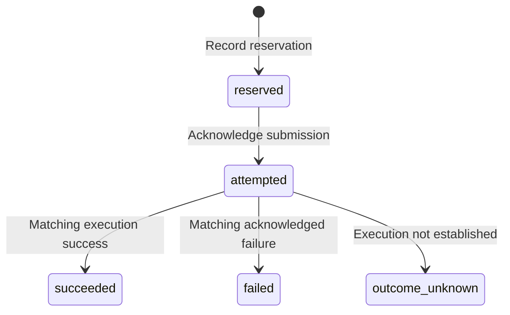

# Debugging an ambiguous browser-workflow outcome

**Purpose:** Show how I investigated uncertain action results, separated evidence from assumptions and tested a correction. Read this for the project's core debugging example.

[Back to the project overview](../README.md) · [Next: discovery and interaction rules](DISCOVERY_AND_INTERACTION.md)

## Context and evidence

The operating workflow discovered visible-feed posts, reviewed each original post and profile, prepared contextual interactions, and recorded only verified outcomes. This case study is reconstructed from archived workflow, feedback and isolated-test records. Original identities, text, screenshots, private configuration, operating windows, source paths and fingerprints are omitted.

The historical record supports:

- Persistent interaction history and explicit post/profile checks were part of the operating method.
- Saved feedback recorded two comment-and-like pairs as verified at the time: the complete comment appeared under the intended post and the liked state was observed separately. This is a historical record, not a new inspection of current platform state.
- A recovery budget was reserved; a compound request involving recovery and observation did not establish whether the recovery action executed.
- Subsequent observations were blocked by tool review, and the trial remained stopped.
- An isolated diagnostic copy introduced clearer recording states and reported 20 passing synthetic checks. The authoritative trial was unchanged and no browser actions occurred during that diagnostic work.

These records do not establish continuous 24-hour execution, a platform-wide success rate or a business outcome.

## Symptom and diagnosis

The recovery allowance was consumed, but the record structure did not clearly distinguish reservation, submitted attempt, acknowledged execution and unknown result. A success/failure-only result field collapsed materially different situations.

| Observation | Supported conclusion | Unsupported conclusion |
|---|---|---|
| Budget reserved | The allowance is consumed | The action executed |
| Request submitted | An attempt was submitted | The action completed |
| Matching execution receipt | That request's result can be recorded | All stop conditions can be released |
| Healthy screenshot | The page appeared healthy at observation time | A specific earlier action succeeded |
| Tool-review denial | Access was denied by the tool layer | It was an ordinary loading failure |
| Conditional action not submitted | No request was sent for that condition | Another attempt or denial occurred |

The recording ambiguity was a diagnosable software issue. It did **not** prove that the ambiguity caused the external review denial: internal review records and a step-level execution receipt were unavailable.

## Isolated correction

Separate budget accounting from execution status:

Preserve these rules (called **invariants** because every transition must keep them true):

1. Reservation is not execution; an unsubmitted request is not an attempt.
2. A matching request identity and execution acknowledgement are needed for success.
3. Observation events remain separate from action outcomes.
4. Code errors, ordinary loading failures and tool-review denials retain distinct classifications.
5. An unknown result keeps the used allowance and stop/interlock state; an interlock prevents further action until the uncertainty is resolved.
6. Even a recorded success does not implicitly resume the live workflow.
7. Completed history and the fixed deadline remain unchanged.

## Public reproduction

[The recovery module](../workflow/recovery.py) is a fresh Python reconstruction of these rules. It records synthetic transitions without invoking a browser. [Its tests](../tests/test_recovery.py) check expected transitions and failure cases; [the generated replay](../outputs/debug_replay.json) shows reservation, submission, unknown outcome and later observation separately.

The original patch depended on private modules and is not bundled. Its 20 archived tests and this repository's tests are **different suites**. Do not add their counts or describe one as a rerun of the other.

The discovery replay checks a related boundary: clicking send is insufficient to count completion. The intended post, account and complete comment must be visible, and the like verified separately. Unknown sends are not retried. Synthetic wrong-target and missing-result cases are reconstructed regression scenarios, not claims that every case occurred as a historical incident.

## Result and unresolved question

The isolated correction improved bookkeeping and testability. The external access restriction remained unresolved; the work did not restore access, authorize another retry or restart the trial. A later healthy observation was not substituted for missing execution evidence.

## Skills demonstrated

Problem decomposition; separating observation from inference; state modeling; error classification; action/evidence correlation; state preservation; isolated reproduction; regression testing; and reporting unresolved causes precisely.
